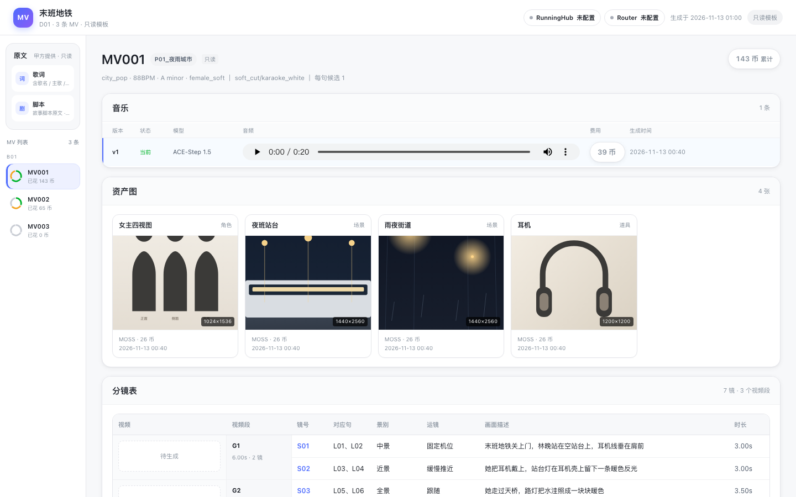

# MV Workbench

**从甲方歌词/脚本到 AI MV 工作台的四步 skill 包。** 一条歌词 → 静态工作台 → MV 文本框架（音乐/资产/分镜/视频段）→ 按选择生成 → 粗剪对齐。

> 面向能运行本地命令的 agent（ZCode / Claude Code / 同类 skill 宿主）。工作台负责展示与配置，真实生成由 agent/CLI 执行。



## 这是什么

- **原文只读**：甲方歌词（歌名/主歌/副歌）与故事脚本原文，不改写、不拆镜。
- **每条 MV 三大项**：音乐列表、关键资产图、标准分镜表（前两列：视频 / 视频段）。
- **视频段**：1 段可含 1+ 镜，时长 ≤10s；每段可生成多条视频，历史保留。
- **Key 配置**：本地服务版右上角“配置 Key”，只写 `~/.config/mv-workbench/keys.json`；原始 Key 不进 HTML/DATA。
- **生成链路**：
  - RunningHub：ACE-Step 音乐、MOSS 资产图、H3 多参视频、S2V 口型
  - Router（TokenTech/new-api）：Muse `muse-video-ext`，`/v1/videos` 异步
- **粗剪**：`zz-mv-trim` 按音乐/歌词对齐多镜头素材。

## 依赖

| 依赖 | 说明 |
|---|---|
| Python 3.9+ | 只用标准库；`mvwb` / Key 服务 / 构建器 |
| ffmpeg + ffprobe | 粗剪、时长/分辨率检查；macOS `brew install ffmpeg`，Windows `winget install Gyan.FFmpeg`，Ubuntu `sudo apt install ffmpeg` |
| Pillow（可选） | 粗剪 contact sheet：`python3 -m pip install Pillow` |
| 一个 agent | 能读 skill、运行本地命令、读写文件 |
| RunningHub API Key | ACE/MOSS/H3/S2V 需要 |
| Router API Key | Muse 需要；默认 new-api/TokenTech `https://router.kcacher.top` |

**不配 Key 也能用**：原文、工作台、MV 框架、分镜/视频段计划都能生成；只有真正提交模型时才需要 Key。

## 安装

### macOS / Linux

```bash
git clone https://github.com/zhouchengke2046/mv-workbench.git
cd mv-workbench
./install.sh
./mvwb doctor
```

- 默认把 8 个 skill 复制到 `~/.agents/skills/`；可用 `--target` 改。
- 默认在 `~/.local/bin/mvwb` 放一个命令；如果不在 PATH，直接跑 `./mvwb`。
- Key 文件：`~/.config/mv-workbench/keys.json`（0600）。

### Windows

```powershell
git clone https://github.com/zhouchengke2046/mv-workbench.git
cd mv-workbench
powershell -ExecutionPolicy Bypass -File .\install.ps1
.\mvwb.cmd doctor
```

- skill 复制到 `%USERPROFILE%\.agents\skills`。
- `mvwb.cmd` 放在 `%USERPROFILE%\.local\bin`；加入 PATH，或直接用 `.\mvwb.cmd`。
- Windows 不强制 `0600`；Key 仍然只存本地文件。建议 clone 到英文路径（避免 cmd 中文路径编码问题）；遇到路径/权限问题用 WSL2。

### 其他 agent

如果宿主用别的 skills 目录（例如 Claude Code 的项目级 skills），安装时指定：

```bash
./install.sh --target /path/to/your/skills
```

## 30 秒 demo

```bash
./mvwb demo
```

会启动本地服务并打开 `http://127.0.0.1:8776/go`。Demo 使用原创虚构歌词/脚本和 SVG 占位资产，不含任何客户内容。

静态只读版也可以直接打开：

```bash
open demo/workbench.html          # macOS
xdg-open demo/workbench.html      # Linux
start demo\workbench.html         # Windows
```

> 静态 `file://` 版没有“配置 Key”按钮；要配置 Key / 刷余额，用 `mvwb server` 的服务版。

## 配置 Key

1. `./mvwb server`（或 `./mvwb demo`）
2. 打开 `http://127.0.0.1:8776/go`
3. 右上角 **配置 Key**
4. 两个密码框：
   - **RunningHub**：ACE/MOSS/H3/S2V
   - **Router**：Muse / TokenTech
5. 留空=不修改；保存后自动刷新余额

命令行也可以：

```bash
./mvwb keys set runninghub
./mvwb keys set router
./mvwb keys status
./mvwb keys balance --write demo/workbench.html
```

Router 默认：

```text
base_url = https://router.kcacher.top
provider = new-api
balance_mode = newapi
```

> `router.kbtech.app` 是 TokenTech 的自定义域名，曾被阿里云 ICP 备案拦截；请用 `router.kcacher.top`。如果你的中转站不同，用 `./mvwb keys config router --base-url ... --balance-mode newapi`。

## 四步使用

### 1. 资料

把甲方歌词/脚本放进 `workspaces/<project>/原文/`：

```text
原文/lyric_original.md   歌名/主歌/副歌，原文
原文/story_script.md     故事脚本原文，不拆镜
原文/lyric.json          L01… 行号映射
```

没有甲方资料时，agent 会先问，再按产品/故事/人物/风格/时长/参考引导起草。

### 2. 空工作台

```bash
./mvwb init my_project
# 替换 workspaces/my_project/原文/ 后，让 agent 生成空工作台
```

Agent 用 `templates/workbench.html` + `DATA.json` 构建；也可以直接：

```bash
python3 scripts/build_workbench.py \
  --template templates/workbench.html \
  --data workspaces/my_project/data.json \
  --out workspaces/my_project/workbench.html
```

打开：

```bash
./mvwb server --workspace my_project
```

### 3. MV 文本框架

Agent 生成 `MV001…MV00N`：音乐计划、资产清单、标准分镜、视频段（≤10s）。此时不花钱。你审核框架，只改点名处。

### 4. 生成内容

先预检：

```bash
./mvwb keys status
./mvwb keys balance
./mvwb quote --model muse-video-ext --seconds 2
```

生成：

```bash
# 音乐（ACE-Step）
./mvwb rh --app 2075301815628943362 --name song_v1 --overrides ... --out ...

# 资产（MOSS）
./mvwb rh --app 2116462203997081601 ...

# H3 多参视频
./mvwb rh --wf 2110943749894402050 ...

# Muse 视频（Router）
./mvwb muse --prompt "..." --seconds 2 --size 720x1280 --out out/muse.mp4
```

如果你直接调脚本，必须经 Key 包装：

```bash
python3 scripts/mv_keys.py exec --need runninghub -- <RH 命令>
python3 scripts/mv_keys.py exec --need router -- <Muse 命令>
```

## 模型与价格（2026-11-13，会变）

| 模型 | 用途 | 价格 | 备注 |
|---|---|---|---|
| ACE-Step 1.5 | 音乐 | 39 币/45s | 中文咬字；Apache-2.0 |
| MOSS | 资产图 | 26 币/张 | 2MP、9:16；文字/手易崩 |
| H3 YZ 多参 | 视频 | 约 19 币/4s | 6 图参考；颜色/场景漂 |
| Muse `muse-video-ext` | 视频 | **2s ≈ ¥1；10s ≈ ¥5** | Router `/v1/videos`；720p、24fps、原生音频 |
| S2V | 口型 | 176 币/8s | 需超分 |

- 真实账单以服务商为准；`./mvwb quote` 只是估算。
- 共享/企业 key 未经账号所有者允许不要用。
- 生成前报价；失败/超时是否扣费以服务商规则为准。

## 目录

```text
mv-workbench/
├─ mvwb / mvwb.cmd           CLI 入口
├─ install.sh / install.ps1  安装
├─ skills/                   8 个 skill
│  ├─ zz-mv-gongzuotai/      四步入口
│  ├─ zz-mv-factory/         模板/DATA 契约
│  ├─ zz-mv-trim/            粗剪
│  ├─ zz-runninghub-cli/     RunningHub API
│  ├─ ace-music/             ACE-Step
│  ├─ h3-prompt-writing/     H3 提示词
│  ├─ zz-manju-image-prompts/MOSS 提示词
│  └─ muse-router/           Muse 提示词 + Router
├─ scripts/
│  ├─ mvwb.py
│  ├─ mv_keys.py
│  ├─ mv_keys_server.py
│  ├─ mv_keys_ui.js
│  ├─ build_workbench.py
│  └─ providers/tokentech_video.py
├─ templates/workbench.html
├─ demo/                     原创 demo（歌词/脚本/占位资产/静音音频）
├─ config/                   models / providers / keys 示例
├─ contracts/                5 个 JSON 契约
├─ tests/
└─ docs/
```

## 安全

- Key 只存 `~/.config/mv-workbench/keys.json`（目录 0700 / 文件 0600）；不进 HTML/DATA/日志/截图。
- Key 配置服务只绑 `127.0.0.1`；POST 校验 Origin/Content-Type；静态版不加载接口。
- `mv_keys.py exec` 会清掉 shell 里残留的 `RUNNINGHUB_API_KEY` / `ROUTER_API_KEY`，只注入 keys.json。
- 无遥测、无云端同步；工作台和产物都在本地。
- **不要把客户歌词/脚本/素材提交到公开仓库**；本仓库的 demo 是原创虚构内容。

## 常见问题

**页面没有“配置 Key”按钮？**  
你打开的是 `file://` 静态版。用 `./mvwb server` 或 `./mvwb demo`，打开 `http://127.0.0.1:8776/go`。

**Router 域名打不开？**  
用 `https://router.kcacher.top`，不要用 `router.kbtech.app`（可能被 ICP 拦截）。API base 是 `https://router.kcacher.top/v1`。

**401 / 无效令牌？**  
Key 错、过期、分组无权限。`./mvwb keys status` 看掩码，`./mvwb keys balance` 看错误；在 Router 面板确认 key 有 `muse-video-ext` 权限。

**429 / 503？**  
限流或渠道未启用；退避重试，不要死循环提交。

**余额不对？**  
Router 2s 实测扣 ¥1，10s ≈ ¥5；RunningHub 扣 RH 币，和钱包余额分开。以服务商账单为准。

**ffmpeg 找不到？**  
`brew install ffmpeg` / `winget install Gyan.FFmpeg` / `sudo apt install ffmpeg`，再 `./mvwb doctor`。

**Windows 和 macOS 有区别吗？**  
核心 Python/CLI 跨平台；差异在安装脚本、`mvwb.cmd` vs `mvwb`、ffmpeg 安装方式、文件权限（Windows 不强制 0600）。遇到 shell 兼容问题建议 WSL2。

## 已知限制

- Muse 的**参考图字段尚未验证**（`image_urls` / `input_reference` / 单个 `image`）；当前只验证了文本生视频 2s。多参考图生产前先测。
- Muse 10s 未实测；当前实测 2s / 720×1280 / 24fps。
- H3/MOSS/ACE/S2V 的实测数据来自 RunningHub 账号；换账号/换工作流版本需重新验证。
- 没有内置剪辑器/批量队列；剪辑走外部工具，批量并发需自己控。
- Windows 只做了兼容性设计，未在干净 Windows 上全量跑过；建议 WSL2。
- 价格/工作流 ID 会变；以 `config/models.json` 的 `as_of` 和服务商为准。

## 开发 / 测试

```bash
python3 -m pip install -r requirements-dev.txt
python3 -m pytest
python3 scripts/build_workbench.py --data demo/data.json --out demo/workbench.html
node --check scripts/mv_keys_ui.js
python3 scripts/check_secrets.py
```

- 测试不调用真实付费 API；用 mock server。
- CI：Ubuntu/macOS/Windows + Python 3.9/3.11。

## License

MIT。第三方归属见 [NOTICE.md](NOTICE.md)：Semi Design tokens 为 MIT；New API 仅通过 HTTP API 调用，不包含其 AGPL 代码；demo 文本为原创虚构内容。
