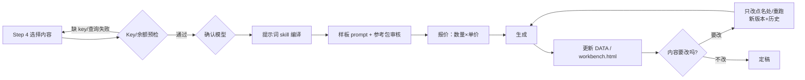

# MV 工作台 · 四步逻辑图与门

## 1. 总图

```mermaid
flowchart TD
    A([开始]) --> B{工作区有甲方歌词/脚本?}
    B -- 有 --> C[读取原文并入库\n不改写、不拆行]
    B -- 没有 --> D[问用户: 有甲方资料吗?]
    D -- 有 --> C
    D -- 没有 --> E[引导用户描述:\n产品/故事/人物/风格/时长/参考]
    E --> F[生成原文草稿\n用户确认]
    F --> C
    C --> G[Step 2 生成 workbench.html\n只有原文, mvs=[]]
    G --> H[问: 一次生成多少条?\n每条多长?\n什么风格?]
    H --> I[Step 3 生成 MV 框架\n音乐计划/资产清单/分镜表/视频段\n纯文本, 无媒体]
    I --> J{框架要改吗?}
    J -- 要改 --> I
    J -- 不改 --> K[问: 这一轮生成几条?\n音乐/资产/视频 可多选]
    K --> L{依赖/报价确认}
    L -- 不通过 --> K
    L -- 通过 --> M[Step 4 生成选中内容]
    M --> N[更新 DATA / workbench.html]
    N --> O{内容要改吗?}
    O -- 要改 --> P[只改点名处/重跑\n新版本+历史]
    P --> M
    O -- 不改 --> Q[定稿]
    Q --> R{继续下一轮?}
    R -- 是 --> H
    R -- 否 --> S([结束])
```

## 2. 停止点（必须停下来问）

| # | 停止点 | 必须问 | 不能做什么 |
|---|---|---|---|
| 1 | 原文入库后 | 原文确认？ | 不能直接生成 MV |
| 2 | 空工作台 HTML 后 | 一次多少条？每条多长？什么风格？ | 不能默认 10 条/45s 直接跑 |
| 3 | MV 框架后 | 框架要改吗？ | 不能直接生成内容 |
| 4 | 框架通过后 | 这一轮几条？音乐/资产/视频（多选）？ | 不能全选全跑 |
| 4.5 | 生成范围后、报价前 | Key 配置了吗？余额够吗？ | 不能跳过 Key/余额预检 |
| 5 | 生成范围后 | 依赖是否补齐？预估费用确认？ | 不能跳过报价门 |
| 6 | 内容生成后 | 哪些要改？ | 不能自动进入下一轮 |

## 3. 门的判定

| 步 | 产物 | 通过条件 | 花钱 |
|---|---|---|---|
| 1 资料 | `原文/lyric_original.md`、`story_script.md`、`lyric.json` | 用户说“原文没问题/用这版” | 0 |
| 2 工作台 | `workbench.html`（`mvs=[]`，只有原文） | 用户回答条数/时长/风格 | 0 |
| 3 框架 | `MVxxx/00_framework.md`、`02_storyboard/storyboard_v1.json`、DATA 更新 | 用户说“框架通过”；生成范围/报价确认 | 0 |
| 4 内容 | 音乐/资产/视频写入 DATA；`spent`/`stages` 更新 | 用户说“可以/定稿” | 按选择 |

## 4. 每步对话脚本

### Step 1

有资料：

> 我拿到甲方的歌词和参考脚本了。我按原文入库，不改写；先确认一下：歌词/脚本就用这版吗？

没资料：

> 我还没看到甲方的歌词和参考脚本。你手上有甲方资料吗？有的话发我；没有的话，我按你描述的范围起草。
>
> 如果按你描述起草，我需要：产品/卖点、故事/人物/冲突/结尾、风格/参考、时长/平台、不能出现的内容。

确认后：

> 原文已锁定。下一步我生成一个只有原文的工作台 HTML，不建 MV、不花钱。

### Step 2

> 工作台 HTML 已生成（只有原文，没有 MV）。
>
> 下一步建 MV 框架前，先定三件事：
> 1. 一次生成多少条？（建议先 5–10 条打样）
> 2. 每条多长？（15/30/45/60s）
> 3. 什么风格？（3D 皮克斯 / 真人短剧 / 真人唱歌对口型 / 日系治愈 / 甲方参考片）

### Step 3

生成框架后：

> MV 框架已生成（纯文本：音乐计划、资产清单、分镜表、视频段），还没有音频/图片/视频。
>
> 框架有没有要改的？要改哪条 MV、哪个镜头、哪句？只改你点名的部分。

框架通过后：

> 框架确认。下一步生成：
> 1. 这一轮生成几条？（全部 / 指定 MV001–MV003 / 先 3 条试跑）
> 2. 生成哪些内容？（音乐 / 资产 / 视频，可多选）
>
> 提醒：视频依赖参考包（多参，不用首帧）和音乐（时间轴/段时长）；只选视频的话要先补资产/音乐。

### Step 4

> 本轮生成了：X 条 MV 的音乐 / Y 张资产 / Z 个视频段，花费 N 币。
>
> 哪些要改？要改哪条 MV、哪个视频段、哪张图/哪首歌？只重跑点名项，历史保留。

## 5. 审核/重跑规则

- **只改点名处**：用户点哪改哪，其余不动。
- **新版本**：每次重跑 `*_v{n+1}.json`，不覆盖；`spent` 累加。
- **音乐锁**：`locked` 后不可重跑/解锁；换音乐=新建 MV。
- **下游过期**：改资产→视频过期；改分镜→视频过期；模板只显示环颜色，状态字段仍写 JSON/DATA。
- **报价门**：真实生成前报数量×单价，确认才跑。

## 6. 数据交接

- 模板/数据契约：`zz-mv-factory` v1.1 的 `SKILL.md`（`DATA.meta/keys/lyric/script/mvs[].stages/detail.music/assets/storyboard.segments.videos/spent`）。
- 生成：`zz-runninghub-cli`（ACE/MOSS/H3/Muse）。
- 粗剪：`zz-mv-trim`。
- 本 skill 不复制模板规则；只负责四步对话、停止点、审核循环和生成范围选择。

## 8. Step 4 内部门（模型/提示词/样板/报价）



| 门 | 必须问 | 产物 |
|---|---|---|
| Key/余额 | keys.json 的两份 key 是否配置？余额够不够？ | `DATA.keys` 掩码/余额快照 |
| 模型确认 | 这批/这段用哪个模型？看模型卡（能力/参考图上限/时长/单价/失败模式） | 模型/工作流 ID 记录 |
| 提示词路由 | 用哪个 prompt skill？先看 1 条样板 | 样板 prompt + 参考图 map |
| 参考包 | 角色/场景/道具/产品实拍齐了吗？先审 | 参考包（不做每镜首帧） |
| 试点 | 先跑 1 条 MV/1 段？ | 样片 |
| 报价 | 数量×单价，确认？ | 预估费用 |

## 9. 漏项检查表

- [ ] 音乐先于视频：框架时长只是计划，音乐对齐后要更新 storyboard/segments。
- [ ] 模型确认不是问名字：给能力/参考图上限/时长/单价/并发/失败模式/提示词 skill。
- [ ] 视频按段确认模型；不同段可不同模型，但同 MV 风格包/调色要统一。
- [ ] 提示词禁跨模型复用：ACE 标签 / MOSS 中文 / H3 结构化 / Muse 自然语言。
- [ ] 参考包：角色四视图/场景板/道具/产品实拍；一图一职；固定图1..图N；不做每镜首帧。
- [ ] 参考图不锁构图/运镜；Muse 不写推拉摇移；H3 动作连续、颜色锁死。
- [ ] 新模型/新 prompt 先跑 1 条样板；第一条全审，其余抽检。
- [ ] QA 按模型：H3 颜色/场景；Muse 脸/构图/审核/文字；MOSS 手/文字；ACE 咬字/时长。
- [ ] 输出/交付：模型 720p → 成片 1080×1920/30fps、字幕、响度、去原声；剪辑另走。
- [ ] 成本/账号：报价、并发、429、退款、多账号 key；shared key 禁用。
- [ ] 版本：model/workflow/prompt/refs/params/seed/cost/time 落盘；DATA 与源 JSON 同步。
- [ ] Key 唯一来源 `~/.config/mv-workbench/keys.json`；生成走 `mvwb` / `mv_keys.py exec --need ... --`；原始 key 不进 HTML/DATA。
- [ ] 服务版用 `mvwb server` 打开；右上角“配置 Key”保存后刷新余额；静态 `file://` 无按钮。
- [ ] 余额超过 6h 先刷新；RunningHub/Router 未配置或查询失败先停。
- [ ] 合规：模型/音乐/歌词授权；广告法/产品宣称；内容审核。
- [ ] 口型：需要真人唱歌对口型时，多参 I2V 不带音频口型，走 S2V/audio-driven。
- [ ] 变体：同歌词多条不要只换 seed；音乐标签/参考包/模型/剪辑一起变。

